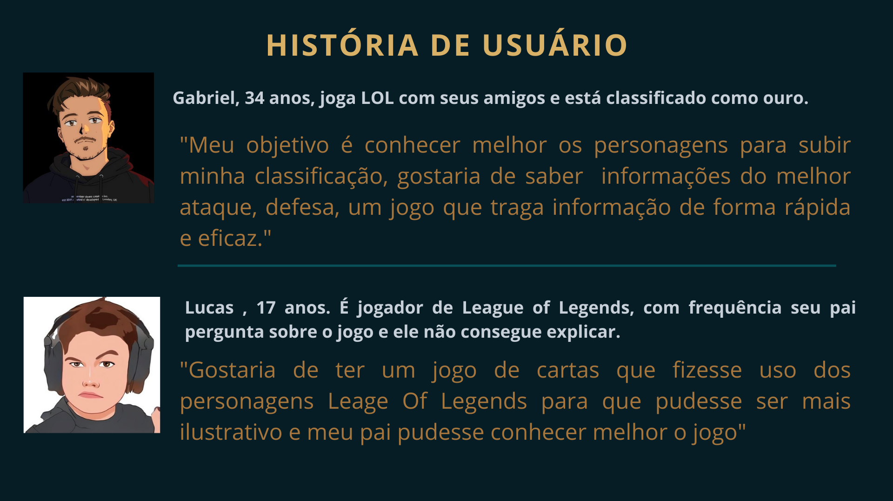
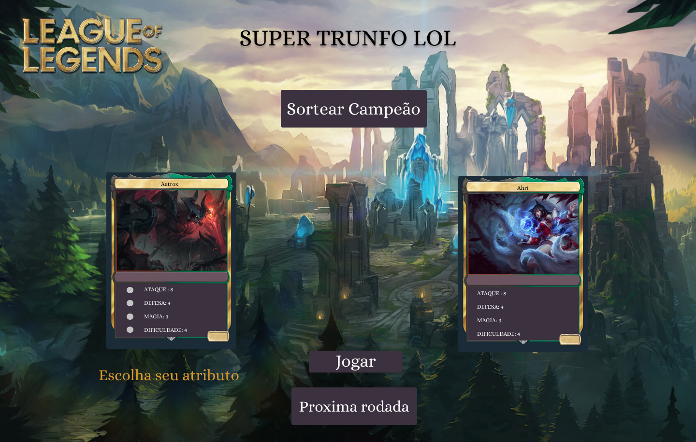

# 🃏 SUPER TRUNFO LOL

---

## 📑 Índice

1. [Descrição do projeto](#1-descrição-do-projeto)  
2. [História de usuário](#2-história-de-usuário)  
3. [Protótipo de alta fidelidade](#3-protótipo-de-alta-fidelidade)  
4. [Ferramentas utilizadas](#4-ferramentas-utilizadas)  
5. [Desenvolvedoras](#5-desenvolvedoras)  

---

## 1. Descrição do projeto

A [Laboratória](https://www.laboratoria.la/br) nos desafiou a escolher um projeto previamente desenvolvido por uma integrante do grupo durante o bootcamp e criar **um novo produto a partir dele**.

Com base em uma pesquisa com usuários, decidimos desenvolver um **jogo de cartas** utilizando personagens do **League of Legends**, inspirado no projeto original da Vanessa ([Data Lovers](https://vanessavb92.github.io/SAP007-data-lovers/src/)).

Assim nasceu o **Super Trunfo LOL**, um jogo onde o usuário compara os atributos da sua carta com os da carta do adversário (máquina).  
Para vencer a rodada, o atributo escolhido deve ter **valor maior** do que o atributo da carta adversária.

🎮 Jogue agora:  
👉 https://juliabb.github.io/super-trunfo-lol/

---

## 2. História de usuário

A aplicação foi desenvolvida pensando nos **fãs de League of Legends** e em suas necessidades de jogar um clássico de forma digital, além de aprender mais sobre os campeões.

O foco do projeto foi:
- Funcionalidade  
- Acessibilidade  
- Experiência do usuário  

O jogo foi idealizado inicialmente para **desktop**, considerando que o público-alvo (gamers de LOL) utiliza majoritariamente computadores para jogar.

---

## 3. Protótipo de alta fidelidade

O protótipo de alta fidelidade foi desenvolvido utilizando a ferramenta **Figma**, permitindo validar a interface e a experiência do usuário antes da implementação.

🔗 Protótipo no Figma:  
https://www.figma.com/file/xRhpBQkoFxHq0yLPZ1eSBy/Untitled

---

## 4. Ferramentas utilizadas

| Ferramenta       | Descrição |
|------------------|-----------|
| HTML5            | Linguagem de marcação |
| CSS3             | Estilização da aplicação |
| JavaScript       | Lógica e interatividade |
| Node.js          | Execução de código JavaScript |
| Git & GitHub     | Controle de versão |
| Figma            | Prototipagem e design |

---

## 5. Desenvolvedoras

<table>
  <tr>
    <td align="center">
       
      <b><a href="https://github.com/Maryssun">Dayanne</a></b> 
      <a href="https://www.linkedin.com/in/dayannemaryssol/" target="_blank">LinkedIn</a>
    </td>
    <td align="center">
       
      <b><a href="https://github.com/juliabb">Julia Benedicto</a></b> 
      <a href="https://www.linkedin.com/in/julia-benedicto/" target="_blank">LinkedIn</a>
    </td>
    <td align="center">
       
      <b><a href="https://github.com/hadamakei">Keila</a></b> 
      <a href="https://www.linkedin.com/in/keila-hadama/" target="_blank">LinkedIn</a>
    </td>
    <td align="center">
       
      <b><a href="https://github.com/TailaMartins">Taila</a></b> 
      <a href="https://www.linkedin.com/in/taila-martins/" target="_blank">LinkedIn</a>
    </td>
    <td align="center">
       
      <b><a href="https://github.com/moreirathais">Thais</a></b> 
      <a href="https://www.linkedin.com/in/thais-moreira-jesus-bonalume/" target="_blank">LinkedIn</a>
    </td>
    <td align="center">
       
      <b><a href="https://github.com/vanessavb92">Vanessa</a></b> 
      <a href="https://www.linkedin.com/in/vanessa-borges-a05b4636/" target="_blank">LinkedIn</a>
    </td>
  </tr>
</table>

---

